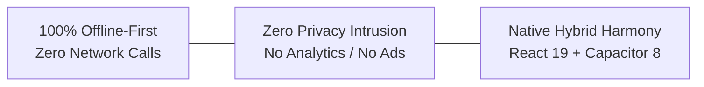
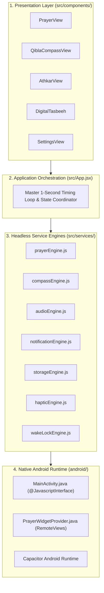

# 🏛️ Architecture & System Design — صلاتي وأذكاري

> **File Reference**: [`src/App.jsx`](file:///C:/Users/midoh/.gemini/antigravity/worktrees/Prayer%20times/create_comprehensive_project_docs/src/App.jsx) | [`src/services/`](file:///C:/Users/midoh/.gemini/antigravity/worktrees/Prayer%20times/create_comprehensive_project_docs/src/services/) | [`android/`](file:///C:/Users/midoh/.gemini/antigravity/worktrees/Prayer%20times/create_comprehensive_project_docs/android/)
> **Master Index**: [README.md](file:///C:/Users/midoh/.gemini/antigravity/worktrees/Prayer%20times/create_comprehensive_project_docs/docs/README.md)

---

## 🎯 1. Engineering Philosophy & Core Invariants

The architecture of **صلاتي وأذكاري** is governed by three foundational pillars:



### 1. 100% Offline-First Invariant
Many mobile Islamic applications rely on third-party REST APIs (such as AlAdhan or remote mosque databases) to fetch prayer times, Hijri dates, or audio recitations. This introduces failure points:
- API outages or slow responses prevent users from knowing prayer times in critical moments.
- Cellular data consumption and network latency degrade mobile battery life.
- Remote logging of user coordinates creates privacy and tracking concerns.

**In صلاتي وأذكاري:**
- **Zero External Network Calls**: The app does not make a single outbound HTTP request during runtime.
- **Local Astronomical Calculations**: Prayer calculations are computed dynamically on-device using spherical trigonometry algorithms via `adhan.js`.
- **Pre-bundled Assets**: All 8 high-fidelity Azan audio files and 55 Arabic WOFF2 fonts are bundled locally within the application distribution.

### 2. Privacy & Zero-Monetization Integrity
- No tracking pixels, no telemetry SDKs, no Google Firebase Analytics, and no ad networks.
- User location coordinates (`latitude`, `longitude`) never leave the device's volatile memory or local `localStorage`.

### 3. Native Hybrid Harmony
Rather than building an entirely native Kotlin/Java app or a pure web PWA, the project leverages **Capacitor 8** to package a modern **React 19** Single-Page Application (SPA) into a high-performance Android standalone APK. Native Java bridges are only deployed where web APIs cannot reach (e.g., Android Home Screen AppWidgets via `RemoteViews`).

---

## 🏗️ 2. High-Level System Architecture & Layered Topology

The codebase is organized into four distinct architectural tiers with strict unidirectional dependencies:



### Tier Responsibilities

| Tier | Directory | Architectural Boundary & Responsibilities |
| :--- | :--- | :--- |
| **Presentation** | `src/components/` | Pure React 19 UI components. Receives state via props, renders semantic HTML with CSS custom properties tokens, and triggers engine methods via user interactions. **Never imports native code directly.** |
| **Orchestration** | `src/App.jsx` | Manages root React state, coordinates view tab navigation (`prayer`, `qibla`, `athkar`, `settings`), and runs the background 1-second interval heartbeat. |
| **Service Engines** | `src/services/` | Headless singleton JavaScript classes. Encapsulates business logic, hardware sensor event listeners, audio synthesis, local storage I/O, and platform bridge calls. |
| **Native Android** | `android/` | Android Gradle project hosting `MainActivity.java` and `PrayerWidgetProvider.java`. Handles OS-level background widgets and native app lifecycle. |

---

## ⏱️ 3. The Master 1-Second Timing & Alert Loop

At the heart of the application is a centralized 1-second interval loop in [`src/App.jsx`](file:///C:/Users/midoh/.gemini/antigravity/worktrees/Prayer%20times/create_comprehensive_project_docs/src/App.jsx). This loop acts as the master scheduler for prayer countdowns, Azan audio dispatching, pre-Iqamah announcements, and Android widget synchronizations.

### Loop Execution Sequence

```mermaid
sequenceDiagram
    autonumber
    participant Loop as App.jsx (setInterval 1s)
    participant Calc as prayerEngine.js
    participant Notif as notificationEngine.js
    participant Audio as audioEngine.js
    participant Native as Android Native Bridge

    Loop->>Loop: Evaluate current timestamp & detect Midnight rollover
    Loop->>Calc: getActivePrayerState(currentTime, settings)
    Calc-->>Loop: { todayTimes, nextPrayer, currentPrayer, countdown, eqamaState }

    Loop->>Notif: updateLockscreenWidget(current, next, countdown, eqama, fullState)
    Note over Notif: Throttled to 1/min or on state change!
    Notif->>Native: window.AndroidWidgetBridge.updateWidgetData(json)

    alt Azan Time Reached (±30s Window & not fired this minute)
        Loop->>Audio: playAzan(reciterKey, prayerName, alertMode)
        Loop->>Notif: sendNotification("حان الآن أذان الفجر", ...)
    else 5-Min Pre-Iqamah Reached
        Loop->>Audio: playPreIqamahVoiceAnnouncement(prayerName, 5)
        Loop->>Notif: sendNotification("اقتربت صلاة الفجر", ...)
    else Iqamah Time Reached
        Loop->>Audio: playMosqueDoubleBeep()
        Loop->>Notif: sendNotification("حان وقت إقامة الصلاة", ...)
    end
```

### Deduplication & Midnight Rollover Handling
To guarantee that alerts never fire multiple times within the same minute, the loop uses persistent React refs storing deduplication keys:

```javascript
// src/App.jsx
const firedAzansRef = useRef(new Set());
const firedEqamasRef = useRef(new Set());
const firedRemindersRef = useRef(new Set());
const firedPreEqamaVoiceRef = useRef(new Set());
const lastDayRef = useRef(new Date().toDateString());

// Inside the 1-second interval:
const currentMinKey = `${currentTime.getFullYear()}-${currentTime.getMonth()}-${currentTime.getDate()}-${currentTime.getHours()}-${currentTime.getMinutes()}`;

// Trigger with 30s tolerance window and set deduplication
const timeDiffMs = Math.abs(currentTime.getTime() - p.time.getTime());
if (timeDiffMs < 30000 && !firedAzansRef.current.has(prayerMinKey)) {
  firedAzansRef.current.add(prayerMinKey);
  audioEngine.playAzan(reciterKey, p.nameAr, alertMode);
}
```

#### Midnight Rollover Invariant
When the device transitions past `00:00:00`, `lastDayRef.current !== todayStr` trips:
1. All four deduplication sets (`firedAzansRef`, `firedEqamasRef`, etc.) are purged.
2. The daily Tasbeeh count in `storageEngine.js` is automatically reset to zero for the new day, preserving all-time statistics.

---

## 🔀 4. Data Flow & State Synchronization

The application employs a **reactive unidirectional data flow** model:

1. **State Initialization**: Upon cold start, `App.jsx` hydrates application settings and Athkar progress synchronously from `localStorage` using [`src/services/storageEngine.js`](file:///C:/Users/midoh/.gemini/antigravity/worktrees/Prayer%20times/create_comprehensive_project_docs/src/services/storageEngine.js).
2. **Audio State Subscription**: The UI subscribes to `audioEngine.subscribe(callback)` to display the floating dismissible Azan banner (`FloatingAzanBanner.jsx`) whenever an audio track starts or stops.
3. **Settings Mutation**: When a user changes calculation methods, city locations, or audio reciters in `SettingsView.jsx`:
   - Updated settings are written immediately to `localStorage`.
   - React state re-renders downstream components.
   - A force-sync is dispatched to the native Android widget bridge to update home screen widgets without waiting for the next minute boundary.

---

## 🔒 5. Security & Build Invariants

- **CSP & Strict Origins**: No remote CDN scripts or stylesheets are loaded at runtime.
- **Java Bridge Hardening**: `AndroidWidgetBridge` methods are strictly typed to receive primitive `String` JSON payloads, sanitized against arbitrary reflection or intent hijacking.
- **ProGuard / R8 Optimization**: When compiling release APKs, the native Android bridge interface is protected via keep rules in ProGuard so that release shrinking does not strip `@JavascriptInterface` methods.
