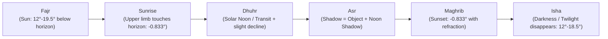
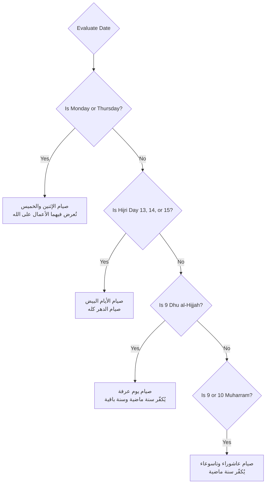

# 🕌 Astronomical Calculation Engine & Hijri Calendar

> **File Reference**: [`src/services/prayerEngine.js`](file:///C:/Users/midoh/.gemini/antigravity/worktrees/Prayer%20times/create_comprehensive_project_docs/src/services/prayerEngine.js) | [`src/data/islamicCalendar.js`](file:///C:/Users/midoh/.gemini/antigravity/worktrees/Prayer%20times/create_comprehensive_project_docs/src/data/islamicCalendar.js)
> **Master Index**: [README.md](file:///C:/Users/midoh/.gemini/antigravity/worktrees/Prayer%20times/create_comprehensive_project_docs/docs/README.md)

---

## 🌌 1. Astronomical Foundation & Solar Geometry

All prayer times in **صلاتي وأذكاري** are computed using deterministic spherical astronomy algorithms without any external API dependencies. The core astronomical engine wraps the high-precision [`adhan.js`](https://github.com/batoulapps/adhan-js) library.

### Solar Altitude & Prayer Time Formulations
Prayer times correspond to specific geometric positions of the Sun relative to the local observer's celestial horizon:

$$\sin(\alpha) = \sin(\phi)\sin(\delta) + \cos(\phi)\cos(\delta)\cos(H)$$

Where:
- $\alpha$: Solar elevation angle above/below the horizon.
- $\phi$: Observer's geographic latitude.
- $\delta$: Solar declination angle for the current day.
- $H$: Hour angle of the sun.



---

## 📐 2. The 12 Global Calculation Methods

Different Islamic authorities worldwide specify different solar depression angles for the astronomical twilight parameters of **Fajr** (subh al-sadiq) and **Isha** (ghiyab al-shafaq).

The application provides native parameter configurations for 12 major authorities:

| # | ID in Code | Islamic Authority / Country | Fajr Angle ($\alpha_F$) | Isha Angle / Offset ($\alpha_I$) |
| :---: | :--- | :--- | :---: | :---: |
| **1** | `Egyptian` | **الهيئة المصرية العامة للمساحة** (Egyptian General Authority of Survey) | **19.5°** | **17.5°** |
| **2** | `UmmAlQura` | **جامعة أم القرى - مكة المكرمة** (Umm Al-Qura University, KSA) | **18.5°** | **+90 min** after Maghrib (*+120 min in Ramadan*) |
| **3** | `MuslimWorldLeague` | **رابطة العالم الإسلامي** (Muslim World League) | **18.0°** | **17.0°** |
| **4** | `NorthAmerica` | **الجمعية الإسلامية لأمريكا الشمالية** (ISNA) | **15.0°** | **15.0°** |
| **5** | `Dubai` | **دائرة الشؤون الإسلامية والعمل الخيري - دبي** | **18.2°** | **18.2°** |
| **6** | `Kuwait` | **وزارة الأوقاف والشؤون الإسلامية - الكويت** | **18.0°** | **17.5°** |
| **7** | `Qatar` | **وزارة الأوقاف والشؤون الإسلامية - قطر** | **18.0°** | **+90 min** after Maghrib |
| **8** | `Karachi` | **جامعة العلوم الإسلامية - كراتشي** | **18.0°** | **18.0°** |
| **9** | `Singapore` | **المجلس الإسلامي السنغافوري** (MUIS) | **20.0°** | **18.0°** |
| **10** | `Turkey` | **رئاسة الشؤون الدينية التركية** (Diyanet) | **18.0°** | **17.0°** |
| **11** | `France` | **اتحاد المنظمات الإسلامية في فرنسا** (UOIF) | **12.0°** | **12.0°** |
| **12** | `MoonsightingCommittee` | **لجنة رؤية الهلال العالمية** (Moonsighting Committee Worldwide) | **18.0°** | **18.0°** |

### Implementation Code Mapping
In [`src/services/prayerEngine.js`](file:///C:/Users/midoh/.gemini/antigravity/worktrees/Prayer%20times/create_comprehensive_project_docs/src/services/prayerEngine.js), calculation methods are resolved through a clean factory method:

```javascript
export const getCalculationMethod = (methodName) => {
  switch (methodName) {
    case 'Egyptian': return CalculationMethod.Egyptian();
    case 'UmmAlQura': return CalculationMethod.UmmAlQura();
    case 'MuslimWorldLeague': return CalculationMethod.MuslimWorldLeague();
    case 'NorthAmerica': return CalculationMethod.NorthAmerica();
    case 'Dubai': return CalculationMethod.Dubai();
    case 'Kuwait': return CalculationMethod.Kuwait();
    case 'Qatar': return CalculationMethod.Qatar();
    case 'Karachi': return CalculationMethod.Karachi();
    case 'Singapore': return CalculationMethod.Singapore();
    case 'Turkey': return CalculationMethod.Turkey();
    case 'France': return CalculationMethod.Other(12.0, 12.0);
    case 'MoonsightingCommittee': return CalculationMethod.MoonsightingCommittee();
    default: return CalculationMethod.Egyptian();
  }
};
```

---

## ⚖️ 3. Juristic Madhab Calculation (Asr Shadow Ratio)

The timing of the **Asr** prayer depends on the juristic determination of shadow lengths:

1. **Shafi'i, Maliki, Hanbali (Standard)**:
   - Asr begins when the shadow of an object equals its own height plus the shadow cast at solar noon:
   $$L_{\text{shadow}} = L_{\text{object}} + L_{\text{noon}}$$
2. **Hanafi**:
   - Asr begins when the shadow of an object equals twice its own height plus the shadow cast at solar noon:
   $$L_{\text{shadow}} = 2 \cdot L_{\text{object}} + L_{\text{noon}}$$

In [`TimingSettings.jsx`](file:///C:/Users/midoh/.gemini/antigravity/worktrees/Prayer%20times/create_comprehensive_project_docs/src/components/TimingSettings.jsx), users can toggle between `shafi` and `hanafi`, which configures `parameters.madhab = Madhab.Hanafi` or `Madhab.Shafi`.

---

## 🌍 4. High-Latitude Twilight Anomalies

At high latitudes (e.g., above $48^\circ\text{N}$ in cities like London, Oslo, Stockholm, or Edmonton), the sun does not dip below $18^\circ$ beneath the horizon during summer months. Calculating Fajr and Isha directly from geometric angles yields `NaN` or unachievable values.

To resolve this astronomical anomaly, the engine supports three high-latitude approximation strategies:
- **`MiddleOfTheNight`**: Divides the period between Sunset and Sunrise in half; Fajr cannot occur before the midnight boundary.
- **`SeventhOfTheNight`**: Divides the night into 7 portions; Fajr occurs at the final seventh portion before sunrise.
- **`AngleBased`**: Calculates twilight proportion relative to the calculation angle over $60^\circ$.

---

## 📅 5. Hijri Calendar & Sunnah Fasting Rules

### 1. Lunar Calendar Synchronization & Manual Calibration
The Islamic calendar is strictly lunar. Algorithmic Hijri conversions (such as Umm al-Qura astronomical estimations) may occasionally differ by $\pm 1$ or $\pm 2$ days from official regional moonsightings declared by local Dar al-Ifta authorities.

To eliminate discrepancy without requiring an external internet connection, [`src/data/islamicCalendar.js`](file:///C:/Users/midoh/.gemini/antigravity/worktrees/Prayer%20times/create_comprehensive_project_docs/src/data/islamicCalendar.js) applies a user-configurable offset:

```javascript
// Applies user-calibrated offset (-2 to +2 days)
export const getAdjustedHijriDate = (date, offsetDays = 0) => {
  const adjusted = new Date(date);
  adjusted.setDate(adjusted.getDate() + offsetDays);
  return calculateHijriDate(adjusted);
};
```

### 2. Automatic Sunnah Fasting Badges
The engine inspects the current Gregorian day of the week and adjusted Hijri date to display golden badge reminders on the `PrayerView` dashboard:



### 3. Dynamic Friday Jumu'ah Prayer Display
On Fridays (`currentTime.getDay() === 5`), the Dhuhr prayer row is dynamically updated in the UI to display **"صلاة الجمعة" (Jumu'ah)** instead of "الظهر", acknowledging the communal Friday prayer.

---

## ⏳ 6. Live Iqamah Window Calculation

The interval between Azan and Iqamah represents a dedicated window for Sunnah prayers and Dua.

The engine computes this active window dynamically:
1. `eqamaTime = new Date(azanTime.getTime() + (eqamaOffsetMinutes * 60 * 1000))`
2. If `now >= azanTime` and `now < eqamaTime`:
   - `isEqamaWindow = true`
   - The UI switches to the emerald live countdown banner displaying remaining minutes and seconds until the congregational prayer starts.
