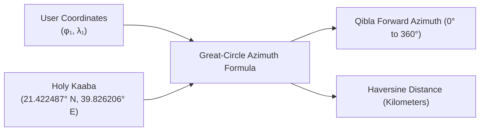
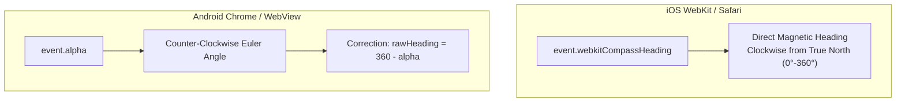
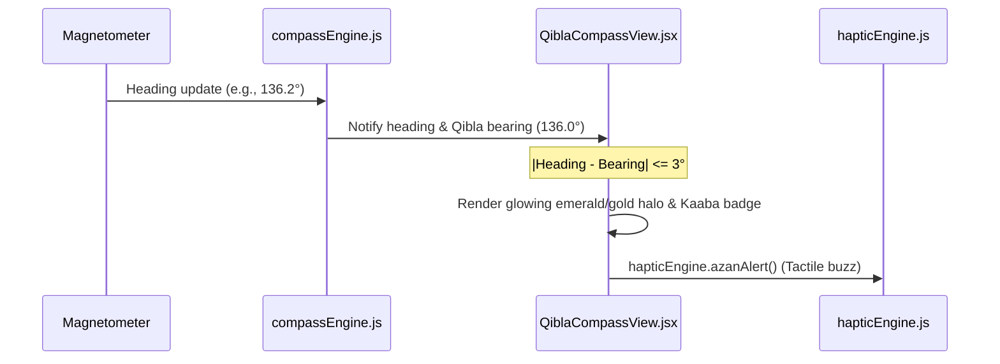

# 🧭 Sensor Fusion & 3D Qibla Compass Engine

> **File Reference**: [`src/services/compassEngine.js`](file:///C:/Users/midoh/.gemini/antigravity/worktrees/Prayer%20times/create_comprehensive_project_docs/src/services/compassEngine.js) | [`src/components/QiblaCompassView.jsx`](file:///C:/Users/midoh/.gemini/antigravity/worktrees/Prayer%20times/create_comprehensive_project_docs/src/components/QiblaCompassView.jsx)
> **Master Index**: [README.md](file:///C:/Users/midoh/.gemini/antigravity/worktrees/Prayer%20times/create_comprehensive_project_docs/docs/README.md)

---

## 🕋 1. Geodesic Mathematics & Kaaba Bearing

The Qibla is defined as the direction along the great circle on the Earth's surface pointing toward the Holy Kaaba at the Masjid al-Haram in Makkah, Saudi Arabia:

$$\text{Kaaba Coordinates: } \phi_K = 21.422487^\circ\text{ N}, \quad \lambda_K = 39.826206^\circ\text{ E}$$



### Great-Circle Forward Azimuth Formula
Given user latitude $\phi_1$, user longitude $\lambda_1$, and Kaaba coordinates $\phi_2, \lambda_2$ (with $\Delta \lambda = \lambda_2 - \lambda_1$):

$$\theta = \text{atan2}\left(\sin(\Delta \lambda)\cos(\phi_2), \; \cos(\phi_1)\sin(\phi_2) - \sin(\phi_1)\cos(\phi_2)\cos(\Delta \lambda)\right)$$

The resulting angle in radians is converted to degrees and normalized to $[0^\circ, 360^\circ)$.

### Haversine Distance Formula
To compute the exact spherical distance to Makkah:

$$a = \sin^2\left(\frac{\Delta \phi}{2}\right) + \cos(\phi_1)\cos(\phi_2)\sin^2\left(\frac{\Delta \lambda}{2}\right)$$
$$d = 2 R \cdot \text{atan2}\left(\sqrt{a}, \sqrt{1-a}\right) \quad (\text{where } R = 6,371\text{ km})$$

---

## 📱 2. Hardware Sensor Fusion (`DeviceOrientationEvent`)

Computing the real-time physical orientation of the device requires fusing magnetometer and gyroscope data from the browser / WebView environment.

### Cross-Platform Coordinate System Discrepancy
Mobile operating systems disagree on how rotation angles are exposed to the DOM:



### Event Registration Pipeline
In [`src/services/compassEngine.js`](file:///C:/Users/midoh/.gemini/antigravity/worktrees/Prayer%20times/create_comprehensive_project_docs/src/services/compassEngine.js):

1. **iOS 13+ Explicit Permission**: Apple requires an explicit user gesture to access motion sensors via `DeviceOrientationEvent.requestPermission()`.
2. **Android Absolute Orientation**: Android devices prefer `deviceorientationabsolute` over standard `deviceorientation` to access the magnetometer fused with gravity without relative drift.

```javascript
// Excerpt from compassEngine.js
if (typeof DeviceOrientationEvent !== 'undefined' && typeof DeviceOrientationEvent.requestPermission === 'function') {
  const response = await DeviceOrientationEvent.requestPermission();
  if (response === 'granted') {
    this.attachListener('deviceorientation');
  }
} else if ('ondeviceorientationabsolute' in window) {
  this.attachListener('deviceorientationabsolute');
} else if ('ondeviceorientation' in window) {
  this.attachListener('deviceorientation');
}
```

---

## 🔄 3. The Low-Pass Filter & Circular Wrap Interpolation

### The $359^\circ \leftrightarrow 0^\circ$ Needle Spin Bug
Raw magnetometer readings suffer from high-frequency noise ($\pm 5^\circ$ jitter). Smoothing this noise with standard linear interpolation creates a catastrophic visual artifact near North:

$$\text{If } \theta_{t-1} = 359^\circ \text{ and } \theta_t = 1^\circ: \quad \frac{359 + 1}{2} = 180^\circ$$

The compass needle would violently whip $180^\circ$ across South instead of advancing $2^\circ$ forward across North!

### The Circular Interpolation Solution
To prevent this wrap-around jump, [`compassEngine.js`](file:///C:/Users/midoh/.gemini/antigravity/worktrees/Prayer%20times/create_comprehensive_project_docs/src/services/compassEngine.js) calculates the shortest angular distance across the circle before applying the smoothing factor ($\alpha = 0.15$):

```javascript
let rawHeading = (rawHeading % 360 + 360) % 360;

// Calculate shortest angular distance across the 360-degree boundary
let diff = rawHeading - this.lastHeading;
if (diff > 180) diff -= 360;
if (diff < -180) diff += 360;

// Apply exponential low-pass filter
this.heading = (this.lastHeading + diff * this.smoothFactor + 360) % 360;
this.lastHeading = this.heading;
```

This ensures the compass dial and golden needle rotate with physical fluid inertia without jitter or boundary-crossing anomalies.

---

## 🎯 4. Haptic & Visual Alignment (The $\pm 3^\circ$ Gate)

When the user physically turns and holds their phone pointing toward the Holy Kaaba within a tight **$\pm 3^\circ$ tolerance window**, the app triggers an immersive multisensory response:



### Tactile Feedback Invariant
To prevent continuous vibration while holding the phone steadily at the threshold (which feels like an electric toothbrush and drains battery), haptic pulses are strictly debounced. A pulse fires upon initial entry into the $\pm 3^\circ$ zone and is suppressed until the user departs the zone by at least $5^\circ$.

---

## 🖐️ 5. Manual Interactive Dial Fallback

If the user is running the app on a desktop browser, a tablet without a built-in magnetometer, or in an environment with high magnetic interference:
- `compassEngine.isSensorSupported` detects the absence of orientation events.
- [`QiblaCompassView.jsx`](file:///C:/Users/midoh/.gemini/antigravity/worktrees/Prayer%20times/create_comprehensive_project_docs/src/components/QiblaCompassView.jsx) smoothly unlocks a **touch & drag interaction**.
- Users can rotate the dial manually with their finger or mouse to explore the angular relationship between North and Makkah.

---

## 💡 6. Screen Wake Lock Integration

During Qibla alignment, users frequently hold the device horizontally for extended periods while calibrating their position.

To prevent the device screen from dimming or locking mid-alignment, the view automatically requests a screen wake lock via [`src/services/wakeLockEngine.js`](file:///C:/Users/midoh/.gemini/antigravity/worktrees/Prayer%20times/create_comprehensive_project_docs/src/services/wakeLockEngine.js) using the native `navigator.wakeLock` API upon mounting, releasing the lock when navigating away.
