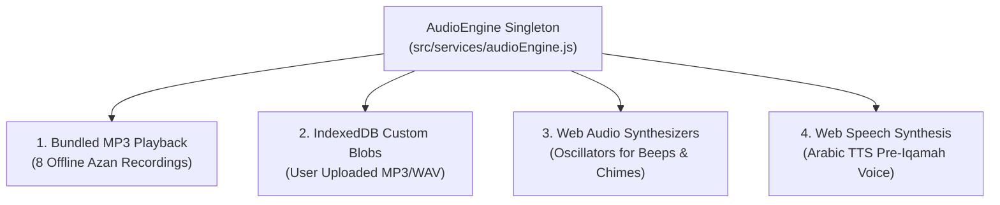
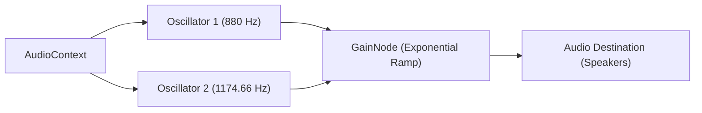

# 🎙️ Audio Playback, Synthesizers & Speech Engine

> **File Reference**: [`src/services/audioEngine.js`](file:///C:/Users/midoh/.gemini/antigravity/worktrees/Prayer%20times/create_comprehensive_project_docs/src/services/audioEngine.js) | [`src/components/AudioSettings.jsx`](file:///C:/Users/midoh/.gemini/antigravity/worktrees/Prayer%20times/create_comprehensive_project_docs/src/components/AudioSettings.jsx)
> **Master Index**: [README.md](file:///C:/Users/midoh/.gemini/antigravity/worktrees/Prayer%20times/create_comprehensive_project_docs/docs/README.md)

---

## 🎵 1. Audio Architecture & Engine Map

The audio subsystem is managed by the singleton [`AudioEngine`](file:///C:/Users/midoh/.gemini/antigravity/worktrees/Prayer%20times/create_comprehensive_project_docs/src/services/audioEngine.js). It provides a unified interface for four distinct audio playback mechanisms:



---

## 🕌 2. Multi-Muadhin Bundled Offline Library

The application packages 8 high-fidelity offline audio recordings in `public/audio/` totaling ~24.74 MB. Users can assign specific reciters globally or customize Fajr separately:

| Asset Name | Size | Reciter / Sanctuary | Description |
| :--- | :---: | :--- | :--- |
| `azan-makkah.mp3` | 3.26 MB | **أذان الحرم المكي الشريف** | Classic Makkah Adhan by Sheikh Ali Ahmed Mullah. |
| `azan-madinah.mp3` | 3.26 MB | **أذان المسجد النبوي الشريف** | Soulful Madinah Adhan by Sheikh Essam Bukhari. |
| `azan-alaqsa.mp3` | 5.13 MB | **أذان المسجد الأقصى المبارك** | Historic Al-Aqsa Adhan with distinctive reverberation. |
| `azan-alafasy.mp3` | 2.86 MB | **الشيخ مشاري راشد العفاسي** | Renowned Kuwaiti melodic Adhan. |
| `azan-abdulbasit.mp3` | 3.63 MB | **الشيخ عبد الباسط عبد الصمد** | Legendary Egyptian Maqam Bayati Adhan. |
| `azan-fajr.mp3` | 3.26 MB | **أذان الفجر المكي** | Includes the morning Tathweeb: *"الصلاة خيرٌ من النوم"*. |
| `takbeer.mp3` | 3.26 MB | **تكبيرات الأذان** | Plays only the opening Takbeerat (stops after 18 seconds). |
| `iqamah-beep.wav` | 0.08 MB | **نغمة إشعار الإقامة** | High-penetration mosque chime. |

### Playback Modes
In [`AudioSettings.jsx`](file:///C:/Users/midoh/.gemini/antigravity/worktrees/Prayer%20times/create_comprehensive_project_docs/src/components/AudioSettings.jsx), users can configure alert modes per prayer:
- **`full`**: Plays the complete Azan audio track until completion (~3 to 4 minutes).
- **`takbeer`**: Automatically terminates playback after **18 seconds** (after the initial Takbeerat).
- **`beep`**: Plays a procedural double-beep chime instead of an audio recording.
- **`silent`**: Dispatches notifications without audio playback.

---

## 💾 3. Custom Audio Persistence via IndexedDB

Users can upload their own MP3 or WAV recitations from device storage.

### Why LocalStorage Was Abandoned
Attempting to store custom audio files in `localStorage` caused catastrophic failures:
- Most mobile web views enforce a strict **5 MB quota** on `localStorage`.
- Encoding a 3 MB MP3 into Base64 expands its footprint by $33\%$ to $\approx 4\text{ MB}$, instantly triggering `QuotaExceededError` and corrupting other application settings.

### The IndexedDB Solution
[`src/services/storageEngine.js`](file:///C:/Users/midoh/.gemini/antigravity/worktrees/Prayer%20times/create_comprehensive_project_docs/src/services/storageEngine.js) uses **IndexedDB** (`prayer_custom_audio_db`) with an object store named `custom_azans`:

```javascript
// Stores raw binary Blob directly without Base64 overhead
export async function saveCustomAzanAudio(id, name, blob) {
  const db = await openAudioDB();
  return new Promise((resolve, reject) => {
    const tx = db.transaction('custom_azans', 'readwrite');
    const store = tx.objectStore('custom_azans');
    const record = { id, name, blob, dateAdded: new Date().toISOString() };
    store.put(record);
  });
}
```

When playing custom audio, `audioEngine` generates a transient blob URL (`URL.createObjectURL(blob)`), maps it into memory, and safely revokes it upon track completion.

---

## 🎛️ 4. Procedural Web Audio API Synthesizers

For lightweight UI feedback (Tasbeeh taps, mosque tone alerts, and offline fallbacks), `audioEngine` generates synthetic tones using native Web Audio oscillators:



### Synthesized Sound Profiles
1. **Mosque Double-Beep (`playMosqueDoubleBeep`)**:
   - First tone: $880\text{ Hz}$ sine wave (0.18s).
   - Second tone: $1174.66\text{ Hz}$ sine wave (0.25s) with exponential decay ramp to $0.001$.
2. **Melodic Mosque Chime (`playMosqueChime`)**:
   - 4-note ascending pentatonic chord ($523.25\text{ Hz}, 659.25\text{ Hz}, 783.99\text{ Hz}, 1046.50\text{ Hz}$).
3. **Tasbeeh Tap (`playTasbeehTapSound`)**:
   - Ultra-short $600\text{ Hz} \to 200\text{ Hz}$ frequency drop over $40\text{ ms}$, creating an authentic mechanical bead click.

---

## 🐛 5. The Ghost Oscillator Memory Leak & Fix

### The Leak Problem
In earlier builds, creating oscillators inside asynchronous functions and scheduling stop routines with `setTimeout` caused memory leaks:
- If a user navigated away, muted, or clicked "Stop Azan" during an active chime sequence, uncancelled `setTimeout` callbacks would fire seconds later.
- Disconnected oscillators remained allocated in memory, eventually exhausting hardware audio channels on mobile devices.

### The Architectural Fix
In commit `d5c185c`, `AudioEngine` was enhanced with explicit tracker registries:

```javascript
class AudioEngine {
  constructor() {
    this.synthOscillators = [];
    this.activeTimeouts = new Set();
  }

  scheduleTimeout(fn, delayMs) {
    const timerId = setTimeout(() => {
      this.activeTimeouts.delete(timerId);
      fn();
    }, delayMs);
    this.activeTimeouts.add(timerId);
    return timerId;
  }

  stopSynth() {
    // 1. Explicitly terminate all active oscillators
    this.synthOscillators.forEach((osc) => {
      try { osc.stop(); osc.disconnect(); } catch (e) {}
    });
    this.synthOscillators = [];

    // 2. Clear all scheduled pending timer callbacks
    this.activeTimeouts.forEach((timerId) => clearTimeout(timerId));
    this.activeTimeouts.clear();
  }
}
```

Every oscillator created is pushed into `this.synthOscillators`, and every timer is registered through `scheduleTimeout`. Calling `stopAll()` or `stopSynth()` guarantees immediate, zero-leak cleanup.

---

## 🗣️ 6. Arabic Text-to-Speech (5-Minute Pre-Iqamah)

To help users prepare for congregational prayer, the app features an automated spoken Arabic reminder:

> *"اقتربت صلاة [الظهر]، متبقي ٥ دقائق على الإقامة. تقبل الله طاعتكم."*

### Engine Implementation
[`audioEngine.playPreIqamahVoiceAnnouncement`](file:///C:/Users/midoh/.gemini/antigravity/worktrees/Prayer%20times/create_comprehensive_project_docs/src/services/audioEngine.js) uses the native **Web Speech Synthesis API**:
- **Language Detection**: Filters available browser voices for Arabic (`ar-SA`, `ar-EG`, or matching `ar`).
- **Pacing**: Configures `rate = 0.9` and `pitch = 1.0` to ensure clear, dignified articulation.
- **Audio Ducking**: Automatically ducks background chimes while speech synthesis is active.
