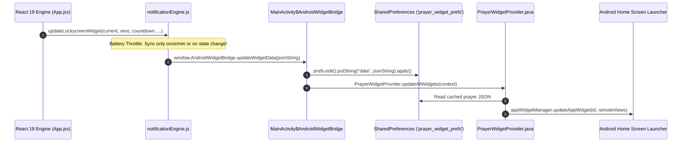

# 📱 Android Native Bridge & Home Screen Widgets

> **File Reference**: [`android/app/src/main/java/com/prayertimes/athkar/MainActivity.java`](file:///C:/Users/midoh/.gemini/antigravity/worktrees/Prayer%20times/create_comprehensive_project_docs/android/app/src/main/java/com/prayertimes/athkar/MainActivity.java) | [`android/app/src/main/java/com/prayertimes/athkar/PrayerWidgetProvider.java`](file:///C:/Users/midoh/.gemini/antigravity/worktrees/Prayer%20times/create_comprehensive_project_docs/android/app/src/main/java/com/prayertimes/athkar/PrayerWidgetProvider.java) | [`src/services/notificationEngine.js`](file:///C:/Users/midoh/.gemini/antigravity/worktrees/Prayer%20times/create_comprehensive_project_docs/src/services/notificationEngine.js)
> **Master Index**: [README.md](file:///C:/Users/midoh/.gemini/antigravity/worktrees/Prayer%20times/create_comprehensive_project_docs/docs/README.md)

---

## 🌉 1. Hybrid Bridge Architecture (Capacitor 8)

**صلاتي وأذكاري** runs inside a customized Android WebView container orchestrated by **Capacitor 8**. While standard notifications and haptics use official Capacitor plugins (`@capacitor/local-notifications`, `@capacitor/haptics`), Android Home Screen AppWidgets cannot be rendered via HTML/CSS. They require native Android `RemoteViews` operated by the OS launcher process.

To bridge this gap without bloating the project with heavy native plugins, a lightweight bidirectional bridge was implemented:



---

## 📱 2. The Native 4x2 Home Screen AppWidget

The home screen widget is declared in `AndroidManifest.xml` and implemented in [`PrayerWidgetProvider.java`](file:///C:/Users/midoh/.gemini/antigravity/worktrees/Prayer%20times/create_comprehensive_project_docs/android/app/src/main/java/com/prayertimes/athkar/PrayerWidgetProvider.java).

### Key Features
- **All 5 Prayers Displayed**: Real-time times for Fajr, Dhuhr, Asr, Maghrib, and Isha.
- **Active Countdown Banner**: Highlights the upcoming prayer with time remaining.
- **Dynamic City Label**: Shows the user's selected city (e.g., `صلاتي وأذكاري • القاهرة`).
- **Interactive Click Intent**: Tapping anywhere on the widget triggers a `PendingIntent` that brings `MainActivity` to the foreground.

### Synchronous Cold-Boot Recovery
Because the widget reads directly from Android `SharedPreferences`, the widget displays accurate prayer times immediately upon phone restart, before the user even opens the app.

---

## 🔋 3. The 1-Second Launcher IPC Battery Drain Shenanigan & Fix

### The Problem
During initial development, `App.jsx` executed this code inside its 1-second interval loop:

```javascript
// NAIVE IMPLEMENTATION (Caused severe battery drain)
useEffect(() => {
  const timer = setInterval(() => {
    // Fired 60 times a minute!
    notificationEngine.updateLockscreenWidget(currentPrayer, nextPrayer, countdownStr, ...);
  }, 1000);
}, []);
```

This caused a catastrophic architectural side effect:
1. Every second, JavaScript called `window.AndroidWidgetBridge.updateWidgetData(...)`.
2. Java called `AppWidgetManager.updateAppWidget()`.
3. Android serialized the entire `RemoteViews` hierarchy and dispatched an **Inter-Process Communication (IPC)** transaction to the home screen launcher process (`com.google.android.apps.nexuslauncher`, Samsung One UI Home, etc.).
4. Doing 60 IPC updates per minute kept the CPU awake, drained the battery, and caused visible micro-stutters in the launcher!

### The Architectural Resolution
In commit `d5c185c`, [`src/services/notificationEngine.js`](file:///C:/Users/midoh/.gemini/antigravity/worktrees/Prayer%20times/create_comprehensive_project_docs/src/services/notificationEngine.js) introduced an intelligent throttle gate:

```javascript
// Excerpt from notificationEngine.js
updateLockscreenWidget(currentPrayer, nextPrayer, countdownOrStr, isEqamaWindow, eqamaCountdownStr, fullState = null, forceSync = false) {
  // Truncate countdown to HH:MM for battery-efficient widget rendering
  const parts = countdownFormatted.split(':');
  const widgetCountdown = parts.length >= 2 ? `${parts[0]}:${parts[1]}` : countdownFormatted;

  // Compute minute-level key + prayer transition state key
  const now = new Date();
  const syncMinuteKey = `${now.getFullYear()}-${now.getMonth()}-${now.getDate()}-${now.getHours()}-${now.getMinutes()}`;
  const prayerStateKey = `${currentPrayer?.id || 'none'}-${nextPrayer?.id || 'none'}-${Boolean(isEqamaWindow)}`;
  const fullSyncKey = `${syncMinuteKey}-${prayerStateKey}`;

  // Throttle check: Skip IPC call if already synced this minute and state unchanged
  if (!forceSync && this.lastWidgetSyncKey === fullSyncKey) {
    return;
  }
  this.lastWidgetSyncKey = fullSyncKey;

  // Execute bridge update across IPC
  if (typeof window !== 'undefined' && window.AndroidWidgetBridge) {
    window.AndroidWidgetBridge.updateWidgetData(JSON.stringify(widgetPayload));
  }
}
```

### Measured Impact
- IPC transactions plummeted from **60 calls/minute $\to$ 1 call/minute** (a $98.3\%$ reduction).
- Widget battery consumption dropped to negligible background levels.
- Immediate updates still occur instantly when state transitions (e.g., entering the Iqamah window or changing cities) via `forceSync: true`.

---

## 🔔 4. Android 13+ Runtime Permissions (`POST_NOTIFICATIONS`)

Starting with Android 13 (API Level 33), apps cannot show notifications without explicit runtime consent.

### Implementation Flow
1. Upon cold start, `NotificationEngine.checkPermission()` queries `@capacitor/local-notifications`.
2. If `prompt`, the app requests permission.
3. If granted, the app registers high-priority channels:
   - `azan-channel`: For urgent call-to-prayer audio alerts with heads-up display.
   - `iqamah-channel`: For pre-prayer reminders and congregational timings.
   - `daily-channel`: For quiet Sunnah fasting and daily Athkar prompts.

---

## 🪟 5. Lockscreen Live Activity Hack via `navigator.mediaSession`

On modern Android and iOS devices, users expect a dynamic lockscreen tile showing the upcoming prayer countdown without unlocking the phone.

### The Hack
Rather than implementing a complex native Android Foreground Service with custom expanded notification views, the engine leverages the standard HTML5 **Media Session API**:

```javascript
if (typeof navigator !== 'undefined' && 'mediaSession' in navigator) {
  navigator.mediaSession.metadata = new MediaMetadata({
    title: `الصلاة القادمة: ${nextPrayer?.nameAr || 'الفجر'}`,
    artist: `صلاتي وأذكاري • ${settings?.location?.nameAr || 'القاهرة'}`,
    album: isEqamaWindow ? `الإقامة خلال: ${eqamaCountdownStr}` : `متبقي على الأذان: ${widgetCountdown}`,
    artwork: [{ src: '/icons/mosque-icon.svg', sizes: '512x512', type: 'image/svg+xml' }]
  });

  // Keep playbackState aligned to prevent unnecessary audio controls
  navigator.mediaSession.playbackState = fullState?.audioState?.isPlaying ? 'playing' : 'none';
}
```

Android interprets this active session as a media card and renders a beautiful, interactive lockscreen live activity showing prayer times, countdowns, and the mosque emblem directly on the lockscreen!
