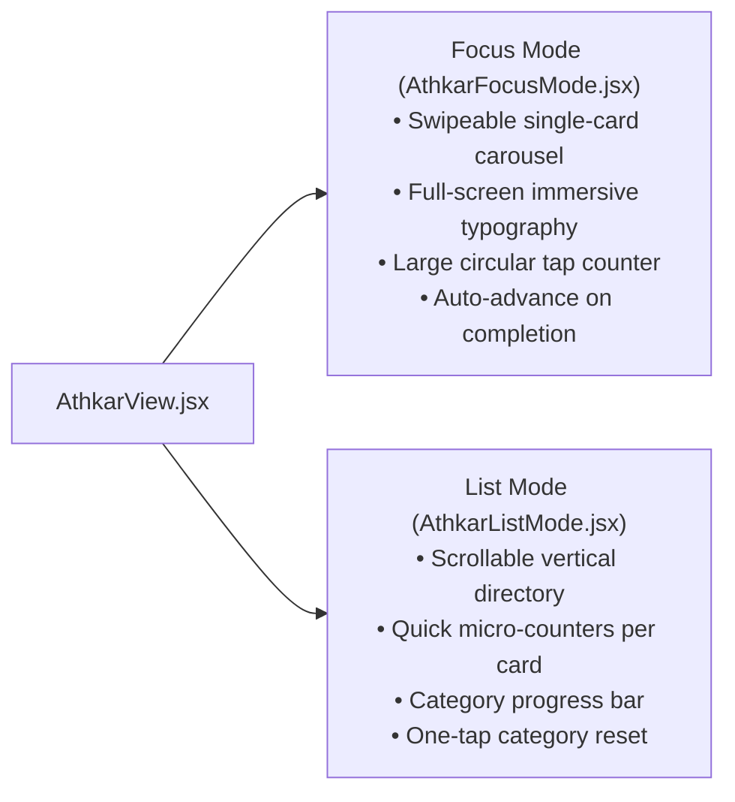
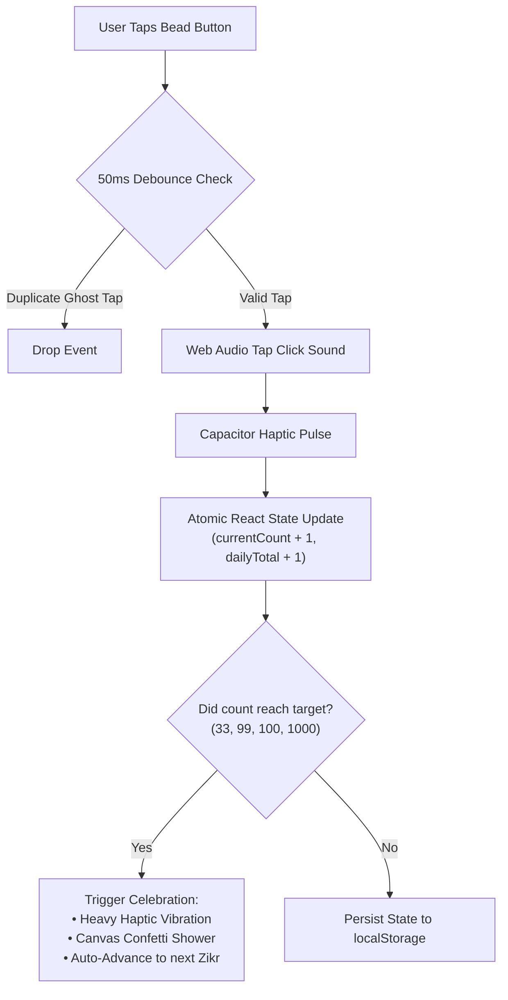

# 📿 Athkar Hub & Smart Electronic Tasbeeh

> **File Reference**: [`src/data/athkarData.js`](file:///C:/Users/midoh/.gemini/antigravity/worktrees/Prayer%20times/create_comprehensive_project_docs/src/data/athkarData.js) | [`src/components/DigitalTasbeeh.jsx`](file:///C:/Users/midoh/.gemini/antigravity/worktrees/Prayer%20times/create_comprehensive_project_docs/src/components/DigitalTasbeeh.jsx) | [`src/components/AthkarFocusMode.jsx`](file:///C:/Users/midoh/.gemini/antigravity/worktrees/Prayer%20times/create_comprehensive_project_docs/src/components/AthkarFocusMode.jsx)
> **Master Index**: [README.md](file:///C:/Users/midoh/.gemini/antigravity/worktrees/Prayer%20times/create_comprehensive_project_docs/docs/README.md)

---

## 📖 1. Islamic Corpus & Sharia Data Integrity

The Athkar database in [`src/data/athkarData.js`](file:///C:/Users/midoh/.gemini/antigravity/worktrees/Prayer%20times/create_comprehensive_project_docs/src/data/athkarData.js) is compiled from canonical Islamic texts, primarily **Hisn al-Muslim** (Fortress of the Muslim), **Sahih al-Bukhari**, **Sahih Muslim**, and **Sunan al-Tirmidhi**.

### Data Integrity Ruleset
Every record in the Athkar database adheres to three strict requirements:
1. **Full Arabic Tashkeel**: Complete vowelization (Fatha, Damma, Kasra, Sukun, Shaddah, and Tanween) is preserved to prevent mispronunciation or alteration of sacred meanings.
2. **Authentic Hadith Virtues (`virtue`)**: The documented spiritual benefit reported in authentic Sunnah is paired with every Zikr.
3. **Canonical Categorization**: Organized into 6 focused categories:
   - **`morning`**: أذكار الصباح (Morning Adhkar)
   - **`evening`**: أذكار المساء (Evening Adhkar)
   - **`afterPrayer`**: أذكار بعد الصلاة المفروضة (Post-Obligatory Prayer)
   - **`sleep`**: أذكار النوم والاستيقاظ (Sleep & Waking Adhkar)
   - **`tasbeeh`**: الأذكار العامة والتسبيح اليومي (General Daily Tasbeeh)
   - **`custom`**: الأذكار المخصصة للمستخدم (User-created Adhkar)

---

## 📱 2. Dual Reading Modes: Focus Mode vs. List Mode

In [`AthkarView.jsx`](file:///C:/Users/midoh/.gemini/antigravity/worktrees/Prayer%20times/create_comprehensive_project_docs/src/components/AthkarView.jsx), users can seamlessly toggle between two viewing modes:



### Focus Mode Architecture
- Uses CSS flex transitions with touch swipe listeners (`onTouchStart`, `onTouchMove`, `onTouchEnd`).
- Tapping anywhere on the recitation card increments the count and triggers a tactile haptic pulse (`hapticEngine.tap()`).
- When the target count is satisfied (e.g., $3/3$ or $100/100$), the card flashes an emerald confirmation aura and automatically advances to the next Zikr after a $400\text{ ms}$ delay.

---

## 📿 3. The Smart Electronic Tasbeeh (`DigitalTasbeeh.jsx`)

The digital tasbeeh simulates the physical experience of a traditional Misbaha through haptics, Web Audio synthesis, and dynamic progress rings:



### 10 Authentic Tasbeeh Presets

| # | ID | Arabic Text | Default Target | Canonical Virtue |
| :---: | :--- | :--- | :---: | :--- |
| **1** | `subhanallah` | **سُبْحَانَ اللهِ** | 33 | تغرس لك نخلة في الجنة وتُحط الخطايا |
| **2** | `alhamdulillah` | **الحَمْدُ لِلَّهِ** | 33 | تملأ الميزان بالخير والبركة |
| **3** | `allahuakbar` | **اللهُ أَكْبَرُ** | 33 | أفضل ما يُفتتح به الدعاء والأذكار |
| **4** | `lailahaillallah` | **لَا إِلَهَ إِلَّا اللهُ** | 100 | أفضل الذكر وخير ما قال النبيون |
| **5** | `astaghfirullah` | **أَسْتَغْفِرُ اللهَ وَأَتُوبُ إِلَيْهِ** | 100 | تفريج الهموم وجلب الرزق ومغفرة الذنوب |
| **6** | `lahawla` | **لَا حَوْلَ وَلَا قُوَّةَ إِلَّا بِاللهِ** | 33 | كنز من كنوز الجنة ودواء لتسعة وتسعين داء |
| **7** | `salawat` | **اللَّهُمَّ صَلِّ وَسَلِّمْ عَلَى نَبِيِّنَا مُحَمَّدٍ** | 100 | من صلى عليّ صلاة صلى الله عليه بها عشراً |
| **8** | `subhanallah_bihamdihi` | **سُبْحَانَ اللهِ وَبِحَمْدِهِ ، سُبْحَانَ اللهِ العَظِيمِ** | 100 | كلمتان خفيفتان على اللسان ثقيلتان في الميزان |
| **9** | `hasbiyallah` | **حَسْبُنَا اللهُ وَنِعْمَ الوَكِيلُ** | 33 | قالها إبراهيم حين ألقي في النار وقالها محمد ﷺ |
| **10** | `yunus_dua` | **لَا إِلَهَ إِلَّا أَنْتَ سُبْحَانَكَ إِنِّي كُنْتُ مِنَ الظَّالِمِينَ** | 33 | لم يدعُ بها مسلم قط في كرب إلا استجاب الله له |

---

## ⚡ 4. Rapid-Tapping Concurrency & Touch Shenanigans

During intense testing with rapid tapping (up to 6 taps per second), four critical edge-case bugs were uncovered and resolved:

### 1. The Ghost Duplicate Tap Bug (Hardware Jitter)
- **Symptom**: Rapid finger taps sometimes triggered both `touchstart` and a synthesized `click` event within $15\text{ ms}$, advancing the count by 2 instead of 1.
- **Fix**: A timestamp gate was installed using `lastTapTimeRef`:
  ```javascript
  const now = Date.now();
  if (now - lastTapTimeRef.current < 50) return; // Prevent duplicate triggers
  lastTapTimeRef.current = now;
  ```

### 2. SVG Overlay Intercepting Taps
- **Symptom**: The circular SVG progress ring layered over the button intercepted pointer events, occasionally causing the browser to misinterpret taps as image drags or ignoring the tap entirely.
- **Fix**: Added `pointer-events: none` to the SVG ring and set `touch-action: manipulation` and `user-select: none` on the parent button.

### 3. State Closure Race Condition
- **Symptom**: Naively doing `setCount(count + 1)` during rapid bursts resulted in lost counts because multiple closures referenced stale snapshot values.
- **Fix**: Switched to pure atomic functional updaters:
  ```javascript
  setTasbeehState((prev) => {
    const isNewDay = prev.lastResetDate !== today;
    const baseDailyTotal = isNewDay ? 0 : (prev.dailyTotal || 0);
    return {
      ...prev,
      currentCount: nextCount,
      dailyTotal: baseDailyTotal + 1,
      lastResetDate: today
    };
  });
  ```

### 4. Celebration Confetti Duplication
- **Symptom**: If the target check was evaluated inside the state updater, React 19's concurrent mode or double-invocations triggered duplicate confetti bursts.
- **Fix**: Evaluated `target > 0 && nextCount === target` outside the state setter using the local calculated `nextCount` variable before calling `setTasbeehState`.

---

## 🌅 5. Midnight Auto-Reset vs. Lifetime Totals

To give users an accurate daily devotional summary without requiring manual resets:
1. Every tap writes the current date string (`today = new Date().toDateString()`) into `lastResetDate`.
2. When the app is opened or when the master timer loop crosses `00:00:00`, the app compares `lastResetDate` with the new day.
3. If unequal, `dailyTotal` resets to `0` while all-time lifetime counts and individual preset targets are strictly preserved.
