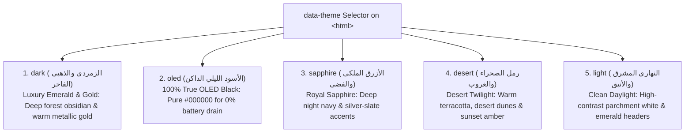

# 🎨 UI/UX Design System, 5 Luxury Themes & RTL Engineering

> **File Reference**: [`src/index.css`](file:///C:/Users/midoh/.gemini/antigravity/worktrees/Prayer%20times/create_comprehensive_project_docs/src/index.css) | [`index.html`](file:///C:/Users/midoh/.gemini/antigravity/worktrees/Prayer%20times/create_comprehensive_project_docs/index.html) | [`public/fonts/`](file:///C:/Users/midoh/.gemini/antigravity/worktrees/Prayer%20times/create_comprehensive_project_docs/public/fonts/)
> **Master Index**: [README.md](file:///C:/Users/midoh/.gemini/antigravity/worktrees/Prayer%20times/create_comprehensive_project_docs/docs/README.md)

---

## 🎨 1. Vanilla CSS Architecture (Zero External CSS Frameworks)

The entire design system of **صلاتي وأذكاري** is engineered using pure **Vanilla CSS** and native CSS custom properties (variables) defined in [`src/index.css`](file:///C:/Users/midoh/.gemini/antigravity/worktrees/Prayer%20times/create_comprehensive_project_docs/src/index.css).

### Why Tailwind / Bootstrap Were Rejected
- **Zero Runtime Overhead**: No CSS post-processors or utility class compilers required.
- **Microscopic Bundle Size**: The entire stylesheet is only $\approx 32\text{ KB}$, minimizing WebView parsing and layout time on lower-end Android hardware.
- **Dynamic Instant Theme Switching**: Swapping themes requires mutating a single DOM attribute (`data-theme`), triggering immediate cascading updates across the entire DOM tree without re-rendering React components.

---

## 🏛️ 2. The 5 Handcrafted Islamic Luxury Themes

Users can select from 5 distinct visual palettes designed for different lighting environments and AMOLED displays:



### Core Design Token Variables
Every theme redefines these standardized design tokens:

| Token Name | Purpose & Usage | Example (`dark` Theme) | Example (`oled` Theme) |
| :--- | :--- | :---: | :---: |
| `--bg-primary` | Main application background | `#061a14` (Deep Emerald) | `#000000` (Pitch Black) |
| `--bg-secondary` | Secondary panels & modal sheets | `#0b2920` | `#080808` |
| `--bg-card` | Elevating prayer cards & timeline rows | `rgba(16, 44, 36, 0.7)` | `rgba(18, 18, 18, 0.85)` |
| `--text-primary` | High-contrast body & header text | `#f8fafc` | `#ffffff` |
| `--text-secondary` | Subtitles, Hadith virtues & labels | `#94a3b8` | `#a1a1aa` |
| `--accent-gold` | Kaaba needle, countdown highlights | `#f59e0b` | `#fbbf24` |
| `--accent-emerald`| Active prayer badges, Iqamah banner | `#10b981` | `#10b981` |
| `--border-color` | Card outlines & subtle dividers | `rgba(245, 158, 11, 0.15)` | `rgba(255, 255, 255, 0.1)` |

---

## 📱 3. Safe-Area Inset Management on Notched Displays

Modern Android and iOS smartphones feature hardware camera punch-holes, status bars, and rounded corner displays.

### The Problem
If web content is not configured with notch awareness:
- Top headers and prayer names collide with status bar battery/clock icons.
- Bottom action buttons or Tasbeeh controls get covered by the Android navigation gesture bar.

### The Architectural Solution
1. **Viewport Meta Configuration**:
   ```html
   <!-- index.html -->
   <meta name="viewport" content="width=device-width, initial-scale=1.0, viewport-fit=cover, maximum-scale=1.0, user-scalable=no" />
   ```
2. **Dynamic Inset CSS Variables**:
   ```css
   :root {
     --safe-top: env(safe-area-inset-top, 0px);
     --safe-bottom: env(safe-area-inset-bottom, 0px);
     --bottom-nav-height: 64px;
   }
   ```
3. **Guaranteed Top Clearance**:
   ```css
   .app-container {
     /* Guarantees full clearance even on Android devices that report 0px for safe-area */
     padding-top: max(var(--safe-top), 60px);
   }
   ```
4. **Guaranteed Bottom Scroll Clearance**:
   ```css
   .main-scroll-content {
     /* Allows all content cards to scroll completely above the 4-tab bottom navigation */
     padding-bottom: calc(var(--bottom-nav-height) + var(--safe-bottom) + 70px);
   }
   ```

---

## 🔤 4. Offline Typography & Bundled WOFF2 Fonts

### The Disappearing Fonts Shenanigan
Early prototypes relied on Google Fonts CDN links:
```html
<!-- DANGEROUS: Fails completely when offline! -->
<link href="https://fonts.googleapis.com/css2?family=Amiri&family=Noto+Naskh+Arabic&display=swap" rel="stylesheet">
```
When users opened the app without an internet connection, the CDN request failed silently. The browser fell back to the system's default generic sans-serif font, ruining the sacred calligraphy aesthetic of the Athkar and Quranic texts.

### The Local Font Bundle Resolution
In commit `bf32879`, all 55 Arabic font variations were downloaded locally into [`public/fonts/`](file:///C:/Users/midoh/.gemini/antigravity/worktrees/Prayer%20times/create_comprehensive_project_docs/public/fonts/) and linked via [`public/fonts/fonts.css`](file:///C:/Users/midoh/.gemini/antigravity/worktrees/Prayer%20times/create_comprehensive_project_docs/public/fonts/fonts.css):
- **`Amiri`**: Traditional Naskh Arabic calligraphy, optimized for Quranic passages, Hadith texts, and Tasbeeh phrases.
- **`Noto Naskh Arabic`**: Highly legible modern Arabic typeface used for numerical metrics, countdown digits, and UI navigation labels.

---

## 🔄 5. The BiDi Parenthesis Flipping Shenanigan & Fix

### The Bug
In mixed-direction Arabic text (Right-to-Left) containing numbers or LTR phrases, the Unicode Bidirectional Algorithm (UBA) treats neutral characters like `(` and `)` as directionally ambiguous.

For example, when rendering:
```jsx
<span>صلاة الظهر (12:15)</span>
```
The browser's layout engine would frequently flip the parenthesis order, displaying visually as:
```text
صلاة الظهر )12:15(
```

### The Invariant & Fix
To eliminate this visual inversion, all parenthesized counts, time formats, and numerical metrics are isolated using `<bdi>` (Bidirectional Isolation) elements:

```jsx
// CORRECT BIDI ISOLATION
<span>صلاة الظهر <bdi dir="ltr">(12:15)</bdi></span>
```

This forces the rendering engine to calculate the layout of the inner numerical expression independently of the outer RTL Arabic paragraph direction.
