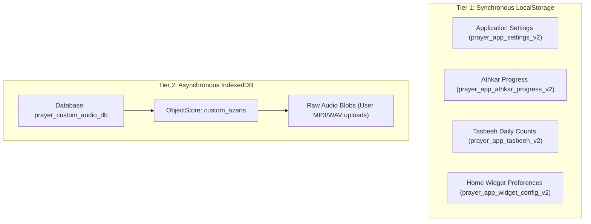
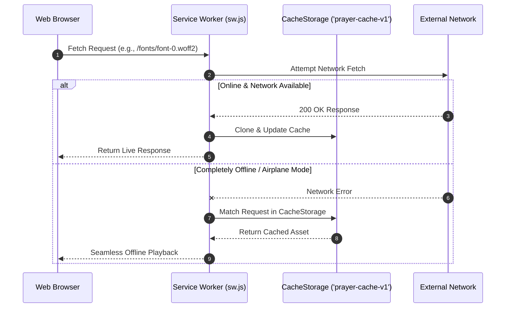

# 💾 Offline Persistence & PWA Service Worker

> **File Reference**: [`src/services/storageEngine.js`](file:///C:/Users/midoh/.gemini/antigravity/worktrees/Prayer%20times/create_comprehensive_project_docs/src/services/storageEngine.js) | [`sw.js`](file:///C:/Users/midoh/.gemini/antigravity/worktrees/Prayer%20times/create_comprehensive_project_docs/sw.js) | [`manifest.json`](file:///C:/Users/midoh/.gemini/antigravity/worktrees/Prayer%20times/create_comprehensive_project_docs/manifest.json)
> **Master Index**: [README.md](file:///C:/Users/midoh/.gemini/antigravity/worktrees/Prayer%20times/create_comprehensive_project_docs/docs/README.md)

---

## 🗄️ 1. Dual-Tier Client Storage Architecture

To provide instantaneous cold starts while supporting large binary audio files, **صلاتي وأذكاري** splits state persistence into two complementary tiers:



### Why LocalStorage for Settings?
- **Zero Layout Shift (CLS = 0)**: Reading settings synchronously during initial React component mounting prevents the flash of unstyled theme or incorrect default city that would occur if settings required an asynchronous database promise.
- **Fail-Safe Fallbacks**: If parsing fails or keys are missing, the storage engine merges existing keys with `DEFAULT_SETTINGS` without crashing the application.

---

## 📋 2. Storage Schema Definitions

### 1. Settings Schema (`prayer_app_settings_v2`)
```typescript
interface AppSettings {
  location: {
    id: string;             // e.g. 'cairo'
    nameAr: string;         // 'القاهرة'
    countryAr: string;      // 'مصر'
    lat: number;            // 30.0444
    lng: number;            // 31.2357
    isManual: boolean;      // GPS vs Selected
  };
  calculationMethod: string;// 'Egyptian' | 'UmmAlQura' | ... (12 methods)
  madhab: 'shafi' | 'hanafi';
  highLatitudeRule: 'MiddleOfTheNight' | 'SeventhOfTheNight' | 'AngleBased';
  hijriOffset: number;     // -2 to +2 days
  prayerOffsets: Record<'fajr' | 'sunrise' | 'dhuhr' | 'asr' | 'maghrib' | 'isha', number>;
  eqamaOffsets: Record<'fajr' | 'dhuhr' | 'asr' | 'maghrib' | 'isha', number>;
  reciter: string;         // 'makkah' | 'madinah' | 'alafasy' | 'abdulbasit' | ...
  fajrReciter: string;     // 'fajr'
  eqamaSound: 'double_beep' | 'tone' | 'voice';
  volume: number;          // 0.0 to 1.0
  preIqamahVoiceEnabled: boolean;
  preIqamahVoiceMinutes: number; // default: 5
  prayerAlertModes: Record<string, 'full' | 'takbeer' | 'beep' | 'silent'>;
  theme: 'dark' | 'oled' | 'sapphire' | 'desert' | 'light';
  timeFormat: '12h' | '24h';
  hapticEnabled: boolean;
  wakeLockEnabled: boolean;
  showLockscreenWidget: boolean;
}
```

### 2. Tasbeeh State Schema (`prayer_app_tasbeeh_v2`)
```typescript
interface TasbeehState {
  currentZikrId: string;    // e.g. 'subhanallah'
  currentCount: number;     // e.g. 14
  target: number;           // 33 | 99 | 100 | 1000 | 0 (free)
  dailyTotal: number;       // Accumulated taps today
  lastResetDate: string;    // e.g. "Mon Sep 07 2026"
  history: Record<string, number>;
}
```

---

## 📴 3. Progressive Web App Service Worker (`sw.js`)

The PWA Service Worker provides full offline caching when the web application is accessed via mobile browsers or installed as a PWA.



### Cache Invalidation & Version Purging
When an updated version of the app is deployed with a new `CACHE_NAME`:
1. The new Service Worker enters the `install` phase and pre-caches critical assets.
2. During the `activate` phase, it iterates through all registered cache keys and deletes obsolete versions:
   ```javascript
   self.addEventListener('activate', (event) => {
     event.waitUntil(
       caches.keys().then((keys) => {
         return Promise.all(
           keys.map((key) => {
             if (key !== CACHE_NAME) {
               return caches.delete(key);
             }
           })
         );
       })
     );
   });
   ```

---

## 📱 4. Web App Manifest (`manifest.json`)

The manifest configures the standalone PWA behavior when installed on Android or desktop:
- **`display: "standalone"`**: Hides the browser URL address bar and back buttons.
- **`orientation: "portrait"`**: Locks the orientation to portrait for the optimal prayer times card layout.
- **`lang: "ar"`, `dir: "rtl"`**: Declares the native Arabic layout direction to the OS shell.
- **Icon Assets**: Includes 192x192 and 512x512 SVG/PNG icons for Android adaptive home screen shortcuts.
