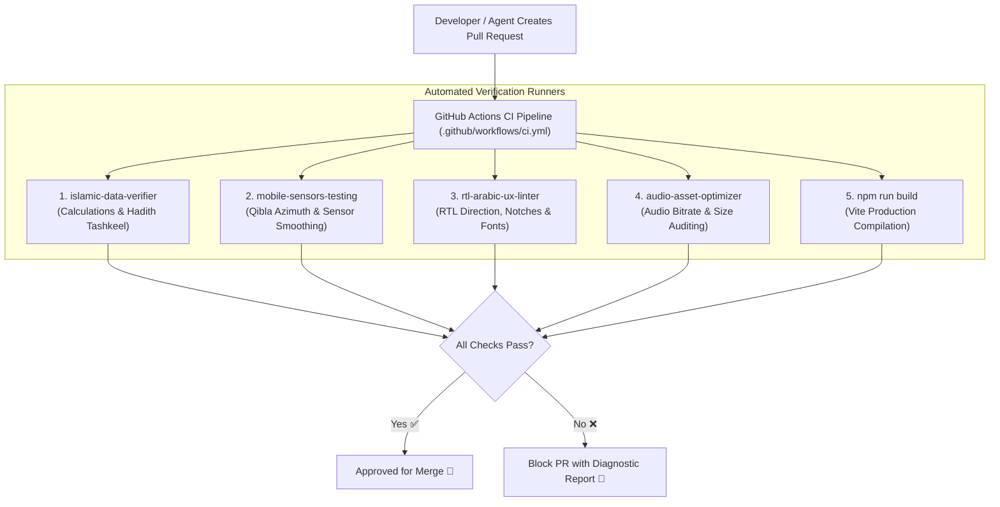

# 🧪 Automated Skills Suite & CI/CD Pipeline

> **File Reference**: [`.agents/skills/`](file:///C:/Users/midoh/.gemini/antigravity/worktrees/Prayer%20times/create_comprehensive_project_docs/.agents/skills/) | [`.github/workflows/ci.yml`](file:///C:/Users/midoh/.gemini/antigravity/worktrees/Prayer%20times/create_comprehensive_project_docs/.github/workflows/ci.yml)
> **Master Index**: [README.md](file:///C:/Users/midoh/.gemini/antigravity/worktrees/Prayer%20times/create_comprehensive_project_docs/docs/README.md)

---

## 🛡️ 1. Verification Architecture & Philosophy

In an Islamic Super App, calculations for prayer times and religious texts must be **100% verifiably accurate**. A calculation bug or corrupted Hadith diacritic mark cannot simply be brushed off as a minor visual defect.

To protect code quality and Islamic integrity, the project defines a multi-layered verification system powered by **custom workspace skills** in `.agents/skills/` and automated **GitHub Actions CI**.



---

## 🕌 2. Skill 1: `islamic-data-verifier`

- **Harness Path**: [`.agents/skills/islamic-data-verifier/scripts/verify-calculations.mjs`](file:///C:/Users/midoh/.gemini/antigravity/worktrees/Prayer%20times/create_comprehensive_project_docs/.agents/skills/islamic-data-verifier/scripts/verify-calculations.mjs)
- **State Test**: [`.agents/skills/islamic-data-verifier/scripts/verify-engine-state.mjs`](file:///C:/Users/midoh/.gemini/antigravity/worktrees/Prayer%20times/create_comprehensive_project_docs/.agents/skills/islamic-data-verifier/scripts/verify-engine-state.mjs)

### What It Verifies
1. **12 Calculation Methods**: Validates that all 12 global calculation methods return valid non-NaN timestamps for standard, polar, and high-latitude coordinates.
2. **Angle Parameters**: Confirms Fajr/Isha angle definitions match the official parameters of the Egyptian Survey, Umm Al-Qura, MWL, ISNA, etc.
3. **10 Tasbeeh Presets**: Asserts that every preset has an authentic title, default target (33, 99, 100), and verified Hadith virtue.
4. **Tashkeel Integrity**: Scans all Athkar texts to verify that Arabic diacritics are present and unbroken.

```bash
# Run Islamic Data Verifier
node .agents/skills/islamic-data-verifier/scripts/verify-calculations.mjs
```

---

## 🧭 3. Skill 2: `mobile-sensors-testing`

- **Harness Path**: [`.agents/skills/mobile-sensors-testing/scripts/simulate-sensors.mjs`](file:///C:/Users/midoh/.gemini/antigravity/worktrees/Prayer%20times/create_comprehensive_project_docs/.agents/skills/mobile-sensors-testing/scripts/simulate-sensors.mjs)

### What It Verifies
1. **Global Azimuth Benchmark Matrix**: Simulates Great-Circle forward azimuth to the Kaaba across 5 major global cities, verifying exact angles within $\pm 0.5^\circ$:
   - **Cairo, Egypt**: Expected $\approx 136^\circ$
   - **Makkah, KSA**: Expected $0^\circ$ (at the Kaaba)
   - **London, UK**: Expected $\approx 119^\circ$
   - **New York, USA**: Expected $\approx 58^\circ$
   - **Jakarta, Indonesia**: Expected $\approx 295^\circ$
2. **Alignment Gate Detection**: Simulates device orientation sweep across $[0^\circ, 360^\circ)$ and verifies that the $\pm 3^\circ$ alignment trigger activates and deactivates symmetrically.
3. **PWA Service Worker Offline Coverage**: Validates that `sw.js` caches all critical HTML, JS, font, and audio assets.

```bash
# Run Mobile Sensors & Offline Tester
node .agents/skills/mobile-sensors-testing/scripts/simulate-sensors.mjs
```

---

## 🎨 4. Skill 3: `rtl-arabic-ux-linter`

- **Harness Path**: [`.agents/skills/rtl-arabic-ux-linter/scripts/lint-arabic-rtl.mjs`](file:///C:/Users/midoh/.gemini/antigravity/worktrees/Prayer%20times/create_comprehensive_project_docs/.agents/skills/rtl-arabic-ux-linter/scripts/lint-arabic-rtl.mjs)

### What It Verifies
1. **RTL Directional Markers**: Confirms `lang="ar"` and `dir="rtl"` on `index.html`.
2. **Safe-Area Insets**: Verifies `--safe-top`, `--safe-bottom`, and `viewport-fit=cover` declarations.
3. **Offline Font Declarations**: Asserts that `fonts.css` links to local `.woff2` files and that no remote `fonts.googleapis.com` links exist.
4. **Touch Ergonomics**: Checks that interactive tap targets specify `touch-action: manipulation`.

```bash
# Run Arabic RTL & UX Linter
node .agents/skills/rtl-arabic-ux-linter/scripts/lint-arabic-rtl.mjs
```

---

## 🔊 5. Skill 4: `audio-asset-optimizer`

- **Harness Path**: [`.agents/skills/audio-asset-optimizer/scripts/compress-audio.mjs`](file:///C:/Users/midoh/.gemini/antigravity/worktrees/Prayer%20times/create_comprehensive_project_docs/.agents/skills/audio-asset-optimizer/scripts/compress-audio.mjs)

### What It Audits
1. **Footprint Analysis**: Scans `public/audio/`, reading file sizes and duration metadata.
2. **Compression Modeling**: Calculates potential footprint reduction under 96 kbps VBR encoding ($24.74\text{ MB} \to 7.48\text{ MB}$).

```bash
# Run Audio Asset Optimizer
node .agents/skills/audio-asset-optimizer/scripts/compress-audio.mjs
```

---

## 🚀 6. GitHub Actions Continuous Integration (`ci.yml`)

The repository includes an automated CI pipeline in [`.github/workflows/ci.yml`](file:///C:/Users/midoh/.gemini/antigravity/worktrees/Prayer%20times/create_comprehensive_project_docs/.github/workflows/ci.yml) running on **Node.js 22**:

```yaml
name: CI Verification

on:
  push:
    branches: [ main, develop ]
  pull_request:
    branches: [ main ]

jobs:
  verify:
    runs-on: ubuntu-latest
    steps:
      - uses: actions/checkout@v4
      - uses: actions/setup-node@v4
        with:
          node-version: 22
          cache: 'npm'

      - name: Install Dependencies
        run: npm ci

      - name: Production Web Build
        run: npm run build

      - name: Run Islamic Calculations Verifier
        run: node .agents/skills/islamic-data-verifier/scripts/verify-calculations.mjs

      - name: Run Engine State Verifier
        run: node .agents/skills/islamic-data-verifier/scripts/verify-engine-state.mjs

      - name: Run Mobile Sensors & Compass Simulator
        run: node .agents/skills/mobile-sensors-testing/scripts/simulate-sensors.mjs

      - name: Run Arabic RTL & UX Linter
        run: node .agents/skills/rtl-arabic-ux-linter/scripts/lint-arabic-rtl.mjs
```

Every Pull Request must pass all 5 gates before code can be merged into `main`.
