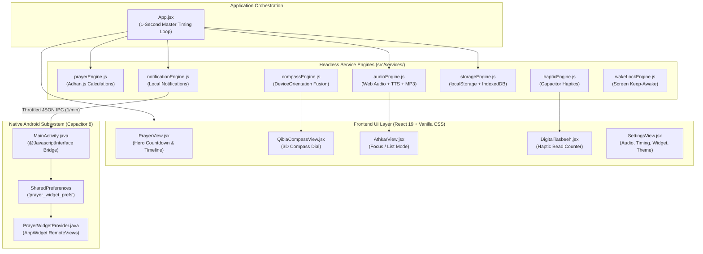

# 📚 Documentation Hub — صلاتي وأذكاري (Prayer-Azkar)

> **Welcome to the definitive architectural, engineering, and operational documentation suite for "صلاتي وأذكاري" (Prayer Times & Athkar).**
> This directory documents the entire system from **A to Z**, covering architectural choices, data integrity guarantees, native Android bridges, sensor mathematics, audio synthesis, and an exhaustive breakdown of every quirk, edge case, and workaround ("the shenanigans") discovered during the evolution of this project.

---

## 🧭 Documentation Map & Chapters

| Chapter | Document | Core Scope & Key Topics |
| :---: | :--- | :--- |
| **01** | [**01-architecture-and-system-design.md**](file:///C:/Users/midoh/.gemini/antigravity/worktrees/Prayer%20times/create_comprehensive_project_docs/docs/01-architecture-and-system-design.md) | **System Architecture & Philosophy**<br/>100% Offline-First invariant, zero external APIs, module topology, 1-second timing alert loop, data flow diagrams. |
| **02** | [**02-astronomical-calculation-engine.md**](file:///C:/Users/midoh/.gemini/antigravity/worktrees/Prayer%20times/create_comprehensive_project_docs/docs/02-astronomical-calculation-engine.md) | **Astronomical Calculations & Hijri Calendar**<br/>12 global calculation methods, twilight angles, Hanafi vs. Shafi'i shadow math, high-latitude anomalies, Hijri calendar adjustment ($\pm 2\text{d}$), Sunnah fasting rules. |
| **03** | [**03-sensor-fusion-and-qibla-compass.md**](file:///C:/Users/midoh/.gemini/antigravity/worktrees/Prayer%20times/create_comprehensive_project_docs/docs/03-sensor-fusion-and-qibla-compass.md) | **Sensor Fusion & 3D Qibla Compass**<br/>Great-Circle forward azimuth geodesics to Makkah, `DeviceOrientation` fusion, iOS `webkitCompassHeading` vs. Android `alpha`, circular wrap smoothing ($359^\circ \leftrightarrow 0^\circ$), $\pm 3^\circ$ haptic alignment. |
| **04** | [**04-audio-synthesis-and-media-playback.md**](file:///C:/Users/midoh/.gemini/antigravity/worktrees/Prayer%20times/create_comprehensive_project_docs/docs/04-audio-synthesis-and-media-playback.md) | **Audio Playback, Synthesizers & Speech Engine**<br/>Multi-Muadhin offline library, IndexedDB Blob persistence, Web Audio oscillator synthesis, audio leak prevention, Arabic Web Speech API Text-to-Speech (`ar-SA`). |
| **05** | [**05-android-native-bridge-and-widgets.md**](file:///C:/Users/midoh/.gemini/antigravity/worktrees/Prayer%20times/create_comprehensive_project_docs/docs/05-android-native-bridge-and-widgets.md) | **Android Native Bridge & Home Screen Widgets**<br/>Capacitor 8 bridge, `MainActivity.java` `@JavascriptInterface`, `PrayerWidgetProvider.java` RemoteViews, launcher IPC throttle, Android 13+ `POST_NOTIFICATIONS`, lockscreen Live Activity. |
| **06** | [**06-athkar-and-smart-tasbeeh.md**](file:///C:/Users/midoh/.gemini/antigravity/worktrees/Prayer%20times/create_comprehensive_project_docs/docs/06-athkar-and-smart-tasbeeh.md) | **Athkar Hub & Smart Electronic Tasbeeh**<br/>Hisn al-Muslim database, Tashkeel diacritic integrity, Focus Mode vs List Mode, 10 Zikr presets, 50ms rapid-touch debounce, concurrency safety, confetti celebration, midnight reset. |
| **07** | [**07-ui-ux-design-system-and-rtl.md**](file:///C:/Users/midoh/.gemini/antigravity/worktrees/Prayer%20times/create_comprehensive_project_docs/docs/07-ui-ux-design-system-and-rtl.md) | **UI/UX Design System, 5 Luxury Themes & RTL**<br/>Vanilla CSS design tokens, Emerald Gold, AMOLED Pure Black, Sapphire, Desert, Light, safe-area notch handling, BiDi parenthesis isolation (`<bdi>`), 100% offline bundled WOFF2 fonts. |
| **08** | [**08-offline-storage-and-pwa.md**](file:///C:/Users/midoh/.gemini/antigravity/worktrees/Prayer%20times/create_comprehensive_project_docs/docs/08-offline-storage-and-pwa.md) | **Offline Persistence & PWA Service Worker**<br/>Dual-tier storage strategy (localStorage for synchronous state + IndexedDB for multi-megabyte audio Blobs), PWA service worker cache strategy, asset pre-caching. |
| **09** | [**09-the-project-shenanigans-and-war-stories.md**](file:///C:/Users/midoh/.gemini/antigravity/worktrees/Prayer%20times/create_comprehensive_project_docs/docs/09-the-project-shenanigans-and-war-stories.md) | **The Project Shenanigans & War Stories**<br/>Chronicle of the 10 most complex bugs, race conditions, edge cases, battery traps, and architectural hacks solved during the project. |
| **10** | [**10-automated-skills-and-verification.md**](file:///C:/Users/midoh/.gemini/antigravity/worktrees/Prayer%20times/create_comprehensive_project_docs/docs/10-automated-skills-and-verification.md) | **Automated Skills Suite & CI/CD Pipeline**<br/>`.agents/skills/` test harnesses (`islamic-data-verifier`, `mobile-sensors-testing`, `rtl-arabic-ux-linter`, `audio-asset-optimizer`), CI verification scripts. |

---

## 🏛️ High-Level Architectural Flow



---

## 👥 Reading Guide by Technical Role

Depending on your engineering focus or review objective, we recommend following these reading paths:

### 1. System Architects & Technical Leads
- **Primary Path**: [01-architecture-and-system-design.md](file:///C:/Users/midoh/.gemini/antigravity/worktrees/Prayer%20times/create_comprehensive_project_docs/docs/01-architecture-and-system-design.md) $\to$ [08-offline-storage-and-pwa.md](file:///C:/Users/midoh/.gemini/antigravity/worktrees/Prayer%20times/create_comprehensive_project_docs/docs/08-offline-storage-and-pwa.md) $\to$ [09-the-project-shenanigans-and-war-stories.md](file:///C:/Users/midoh/.gemini/antigravity/worktrees/Prayer%20times/create_comprehensive_project_docs/docs/09-the-project-shenanigans-and-war-stories.md).
- **Focus**: State management patterns, memory safety, battery conservation, offline data longevity, and avoiding architectural pitfalls.

### 2. Android & Mobile Hybrid Developers
- **Primary Path**: [05-android-native-bridge-and-widgets.md](file:///C:/Users/midoh/.gemini/antigravity/worktrees/Prayer%20times/create_comprehensive_project_docs/docs/05-android-native-bridge-and-widgets.md) $\to$ [03-sensor-fusion-and-qibla-compass.md](file:///C:/Users/midoh/.gemini/antigravity/worktrees/Prayer%20times/create_comprehensive_project_docs/docs/03-sensor-fusion-and-qibla-compass.md) $\to$ [04-audio-synthesis-and-media-playback.md](file:///C:/Users/midoh/.gemini/antigravity/worktrees/Prayer%20times/create_comprehensive_project_docs/docs/04-audio-synthesis-and-media-playback.md).
- **Focus**: Capacitor bridge mechanics, `@JavascriptInterface` security, RemoteViews XML layouts, Android Doze mode, and hardware sensor fusion.

### 3. Sharia Auditors & Islamic Content Reviewers
- **Primary Path**: [02-astronomical-calculation-engine.md](file:///C:/Users/midoh/.gemini/antigravity/worktrees/Prayer%20times/create_comprehensive_project_docs/docs/02-astronomical-calculation-engine.md) $\to$ [06-athkar-and-smart-tasbeeh.md](file:///C:/Users/midoh/.gemini/antigravity/worktrees/Prayer%20times/create_comprehensive_project_docs/docs/06-athkar-and-smart-tasbeeh.md) $\to$ [10-automated-skills-and-verification.md](file:///C:/Users/midoh/.gemini/antigravity/worktrees/Prayer%20times/create_comprehensive_project_docs/docs/10-automated-skills-and-verification.md).
- **Focus**: Solar angle definitions, Madhab shadow formulations, Hadith citations from Hisn al-Muslim, full Arabic vowelization (Tashkeel), and automated regression verification.

### 4. Frontend & UI/UX Engineers
- **Primary Path**: [07-ui-ux-design-system-and-rtl.md](file:///C:/Users/midoh/.gemini/antigravity/worktrees/Prayer%20times/create_comprehensive_project_docs/docs/07-ui-ux-design-system-and-rtl.md) $\to$ [06-athkar-and-smart-tasbeeh.md](file:///C:/Users/midoh/.gemini/antigravity/worktrees/Prayer%20times/create_comprehensive_project_docs/docs/06-athkar-and-smart-tasbeeh.md).
- **Focus**: Vanilla CSS custom properties, RTL text rendering, safe-area inset management on notched devices, touch response optimization, and offline WOFF2 font caching.

---

## 🧩 Component & Service Cross-Reference Matrix

The table below shows how every UI view interacts with the underlying headless services:

| Component File | Primary Service Engine | Secondary Services | Underlying Native / Web API |
| :--- | :--- | :--- | :--- |
| [`src/components/PrayerView.jsx`](file:///C:/Users/midoh/.gemini/antigravity/worktrees/Prayer%20times/create_comprehensive_project_docs/src/components/PrayerView.jsx) | `prayerEngine.js` | `storageEngine.js`, `hapticEngine.js` | DOM animation, LocalStorage |
| [`src/components/QiblaCompassView.jsx`](file:///C:/Users/midoh/.gemini/antigravity/worktrees/Prayer%20times/create_comprehensive_project_docs/src/components/QiblaCompassView.jsx) | `compassEngine.js` | `hapticEngine.js`, `wakeLockEngine.js` | `DeviceOrientationEvent`, Screen Wake Lock API |
| [`src/components/DigitalTasbeeh.jsx`](file:///C:/Users/midoh/.gemini/antigravity/worktrees/Prayer%20times/create_comprehensive_project_docs/src/components/DigitalTasbeeh.jsx) | `storageEngine.js` | `hapticEngine.js`, `audioEngine.js` | Web Audio synthesizer, `canvas-confetti` |
| [`src/components/AthkarView.jsx`](file:///C:/Users/midoh/.gemini/antigravity/worktrees/Prayer%20times/create_comprehensive_project_docs/src/components/AthkarView.jsx) | `storageEngine.js` | `hapticEngine.js` | LocalStorage progress tracking |
| [`src/components/AudioSettings.jsx`](file:///C:/Users/midoh/.gemini/antigravity/worktrees/Prayer%20times/create_comprehensive_project_docs/src/components/AudioSettings.jsx) | `audioEngine.js` | `storageEngine.js` | HTML5 Audio, IndexedDB binary storage |
| [`src/components/WidgetSettings.jsx`](file:///C:/Users/midoh/.gemini/antigravity/worktrees/Prayer%20times/create_comprehensive_project_docs/src/components/WidgetSettings.jsx) | `notificationEngine.js` | `storageEngine.js` | Android `@JavascriptInterface` IPC |
| [`src/components/TimingSettings.jsx`](file:///C:/Users/midoh/.gemini/antigravity/worktrees/Prayer%20times/create_comprehensive_project_docs/src/components/TimingSettings.jsx) | `prayerEngine.js` | `storageEngine.js` | Adhan calculation parameters |

---

## ⚡ Quick Start & Development Setup

```bash
# 1. Install dependencies
npm install

# 2. Launch local Vite development server (Port 3000)
npm run dev

# 3. Compile production web bundle
npm run build

# 4. Sync web assets into Android project
npx cap sync android

# 5. Build Native Android Debug APK via Gradle
cd android
./gradlew.bat assembleDebug
```
